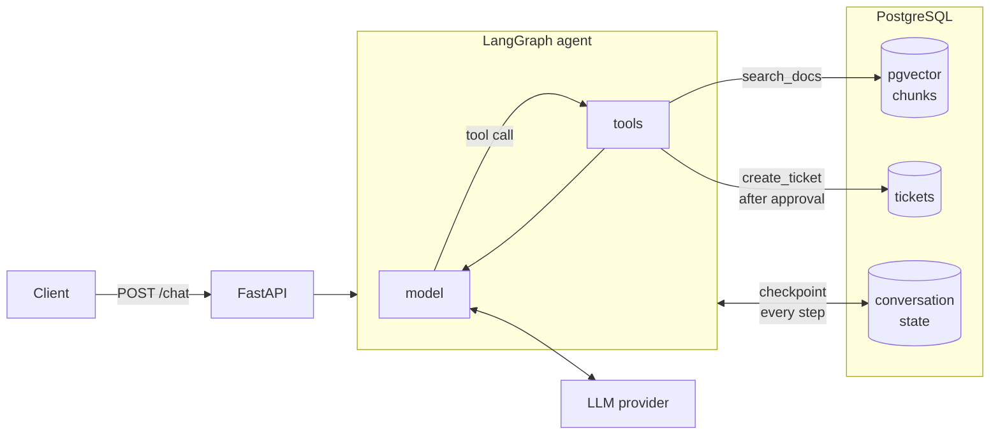

# Agentic Docs Assistant

[](https://github.com/linusdominic/agentic-docs-assistant/actions/workflows/ci.yml)

A support agent that answers questions from a product's documentation and files a ticket when the docs are not enough. It is a small, complete example of a production-shaped agent service:

- **LangGraph** runs the agent loop, pauses for human approval, and resumes.
- **PostgreSQL + pgvector** stores document embeddings, tickets, and every conversation's state.
- **FastAPI** exposes the agent over HTTP, with token streaming.
- **Docker** packages it for **Google Cloud Run** and Cloud SQL.

The sample knowledge base is the documentation of a fictional note-taking app, Nimbus Notes. Swap in your own Markdown files and the agent answers from those instead.

## How it works



1. **Ingestion** splits each document into heading-aware chunks, embeds them locally, and stores them in a `vector` column with an HNSW index.
2. **A chat request** enters the graph. The model decides whether to call a tool. `search_docs` embeds the question and returns the closest chunks, each labelled with its source file. The model answers from those passages and cites the files.
3. **Actions need approval.** When the model calls `create_ticket`, the graph pauses with an interrupt and the API returns `needs_approval`. Nothing is written until the client calls `/chat/approve`.
4. **State lives in Postgres.** A checkpoint is saved after every step, keyed by `thread_id`. That gives the agent memory across requests, lets a paused run resume later, and means the API holds no state of its own, so it can scale out or restart freely.

## Quick start

You need [uv](https://docs.astral.sh/uv/), Docker, and an API key for a chat model.

```bash
git clone https://github.com/linusdominic/agentic-docs-assistant.git
cd agentic-docs-assistant
cp .env.example .env        # then set ANTHROPIC_API_KEY in .env

make install                # install dependencies
make db                     # PostgreSQL + pgvector on localhost:5433
make ingest                 # chunk, embed and store the sample docs
make dev                    # API on http://localhost:8000
```

Interactive API docs are at <http://localhost:8000/docs>.

To run everything in containers instead, use `make up`.

### Choosing a model

`LLM_MODEL` takes any LangChain chat model string in the form `provider:model`, so switching providers is a configuration change. The default is `anthropic:claude-opus-5-5`. For a Google-hosted model on Vertex AI, install `langchain-google-vertexai` and set a `google_vertexai:` model.

Embeddings run locally with [fastembed](https://github.com/qdrant/fastembed) (`BAAI/bge-small-en-v1.5`, 384 dimensions), so ingestion and retrieval need no API key.

## Using the API

The responses below are real output from the running service, using the sample knowledge base.

Ask a question. `thread_id` is optional: leave it out to start a new conversation and the response returns a generated id.

```bash
curl -s localhost:8000/chat -H 'content-type: application/json' \
  -d '{"message": "Can I get a refund on a yearly plan renewal?", "thread_id": "live-1"}'
```

```json
{
  "thread_id": "live-1",
  "status": "complete",
  "reply": "Yes, if you ask **within 14 days of the renewal date**.\n\n**To request it:** go to **Settings → Billing → Request refund**. The money goes back to your original payment method within 5–10 business days.\n\nIf it's been more than 14 days since the renewal, the documentation doesn't mention a refund option. You can still cancel, and you'll keep access until the end of the billing period you've paid for. I can also file a support ticket so someone on the team can look at your case.\n\n(source: billing.md)",
  "sources": ["billing.md"],
  "pending_action": null
}
```

Send the same `thread_id` to continue the conversation. The agent remembers what came before:

```bash
curl -s localhost:8000/chat -H 'content-type: application/json' \
  -d '{"message": "And how long does the money take to arrive?", "thread_id": "live-1"}'
```

```json
{
  "thread_id": "live-1",
  "status": "complete",
  "reply": "Refunds go back to your original payment method within **5 to 10 business days**. Depending on your bank or PayPal, it may take a little longer to appear on your statement.\n\n(source: billing.md)",
  "sources": [],
  "pending_action": null
}
```

`sources` lists the files retrieved during that turn. It is empty here because the agent answered from the conversation without searching again.

Ask for something the agent has to act on, and it stops for approval. Nothing is written yet:

```bash
curl -s localhost:8000/chat -H 'content-type: application/json' \
  -d '{"message": "Sync keeps failing with error S-401 even after I signed out and back in twice on my Mac, app version 4.2.1. Please open a support ticket.", "thread_id": "live-2"}'
```

```json
{
  "thread_id": "live-2",
  "status": "needs_approval",
  "reply": null,
  "sources": [],
  "pending_action": {
    "action": "create_ticket",
    "title": "Sync fails with error S-401 on macOS (v4.2.1)",
    "description": "User reports that sync keeps failing with error S-401.\nPlatform: Mac\nApp version: 4.2.1\nTroubleshooting already tried: signed out and back in twice. The error keeps coming back.\nUser asked to be put in touch with support."
  }
}
```

Approve it (or send `"approved": false` to decline), and the run resumes where it paused:

```bash
curl -s localhost:8000/chat/approve -H 'content-type: application/json' \
  -d '{"thread_id": "live-2", "approved": true}'
```

```json
{
  "thread_id": "live-2",
  "status": "complete",
  "reply": "I've filed support ticket **#1**: \"Sync fails with error S-401 on macOS (v4.2.1)\". It says you're on a Mac with version 4.2.1 and that signing out and back in twice didn't fix it. A support engineer will follow up.\n\nThe docs say S-401 means your login session has expired, and their only fix is to sign out and back in. You've already done that, so there's nothing else in the docs to try. […]",
  "sources": ["api.md", "troubleshooting.md"],
  "pending_action": null
}
```

The reply is shortened here; `[…]` marks the cut.

Stream a reply as server-sent events:

```bash
curl -N localhost:8000/chat/stream -H 'content-type: application/json' \
  -d '{"message": "What are the API rate limits on the Team plan?", "thread_id": "live-4"}'
```

```
event: tool_call
data: {"name": "search_docs", "args": {"query": "API rate limits Team plan"}}

event: token
data: {"text": "On the Team plan, each"}

event: token
data: {"text": " API token can make **600 requ"}

event: token
data: {"text": "ests per minute**.\n\n-"}

(18 more token events)

event: done
data: {"thread_id": "live-4", "status": "complete"}
```

| Endpoint | Purpose |
|---|---|
| `GET /health` | Liveness check |
| `POST /chat` | Send a message, wait for the full reply |
| `POST /chat/stream` | Send a message, receive `tool_call`, `token`, `approval_required`, `error` and `done` events |
| `POST /chat/approve` | Approve or decline the action a paused thread is waiting on |

Set `API_KEY` to require an `X-API-Key` header on the chat routes.

## Project layout

```
src/docs_agent/
  agent.py       LangGraph graph: model <-> tools loop, system prompt
  tools.py       search_docs (retrieval) and create_ticket (approval-gated action)
  api.py         FastAPI app: chat, streaming, approvals, API-key check
  db.py          Connection pool, schema, vector store, ticket store
  ingest.py      Ingestion CLI: read -> chunk -> embed -> store
  chunking.py    Heading-aware Markdown splitter
  embeddings.py  Local embedding model
  config.py      Settings from environment variables
knowledge_base/  Sample documents
tests/           Unit tests and PostgreSQL integration tests
deploy/          Cloud Run deployment script and guide
```

## Tests

```bash
make test               # unit tests: no database, network or API key
make test-integration   # adds the tests that run against PostgreSQL + pgvector
make lint
```

The unit tests drive the real graph and the real FastAPI app with a scripted chat model and in-memory stores, so they cover tool calling, per-thread memory, the approval flow, and streaming without calling a model provider. The integration tests ingest the sample documents into pgvector and check that retrieval returns the right file for a set of questions, and that a conversation saved by one process is readable by another. CI runs both on every push.

## Deploying to Cloud Run

The same container runs on Cloud Run with Cloud SQL for PostgreSQL. See [deploy/README.md](deploy/README.md) for the setup and [deploy/cloudrun.sh](deploy/cloudrun.sh) for the deploy command.

## Design notes

- **One database for three jobs.** Vectors, application data and agent state all sit in PostgreSQL. That is one service to run, back up and secure, and it is enough until the corpus reaches many millions of chunks.
- **Tools are built around interfaces.** `make_tools` takes a retriever and a ticket store, so tests pass in fakes and a different backend can be swapped in without touching the agent.
- **Approval is part of the graph, not the client.** The interrupt is raised inside the tool, so no caller can skip it, and the pending action survives a restart because it is checkpointed.
- **The API is stateless.** Any instance can serve any request for any thread, which is what lets Cloud Run add and remove instances under load.

## Limitations

- Ingestion handles Markdown and plain text only, and re-embeds a whole file when it changes.
- Retrieval is vector-only. Hybrid search (adding PostgreSQL full-text) and reranking would help on larger corpora.
- There are no user accounts: anyone with the API key can read a thread if they know its id.
- Long agent runs hold the HTTP request open. A queue-backed worker is the next step for longer tasks.

## License

MIT
